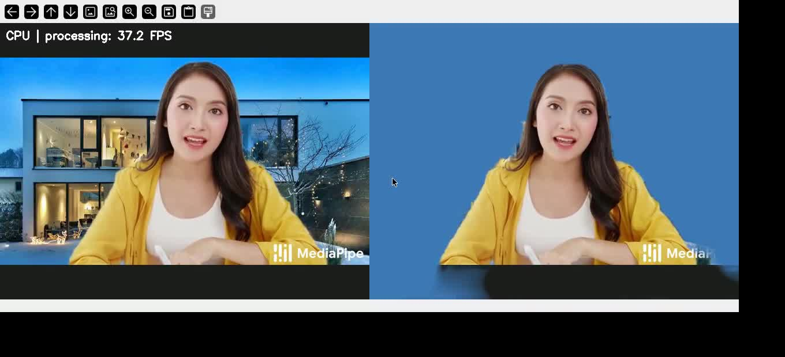

# Удаление фона с видео в реальном времени

## Выбор решения

Для этой работы я выбрал [MediaPipe Selfie Segmentation](https://chuoling.github.io/mediapipe/solutions/selfie_segmentation.html). Использую готовую модель SelfieSegmenter в версии landscape через [Image Segmenter](https://ai.google.dev/edge/mediapipe/solutions/vision/image_segmenter). Это лёгкая свёрточная сеть на основе MobileNetV3, которая выделяет человека на изображении. Вход модели — 256×144, а кадр приложения — 640×480.

Модель подходит для этой задачи, потому что работает на CPU и рассчитана на человека рядом с камерой. Обучать её не нужно. Файл модели приложен в `models/`; если его удалить, приложение автоматически скачает модель из официального источника.

## Как работает приложение

Приложение получает каждый кадр через OpenCV, переводит его в RGB и передаёт в модель. Карту вероятностей человека увеличиваю до размера кадра и сглаживаю по границам. Для уменьшения мерцания беру 80% текущей маски и 20% предыдущей. Затем смешиваю исходный кадр с новым фоном по этой маске и показываю результат в окне.

Реализовал три режима: однотонный фон, размытие исходного фона и замена фона изображением. Можно включить сравнение: слева исходный кадр, справа результат. Инференс явно выполняется на CPU, обработка кадров не пропускается.

## Установка и запуск

Нужен Python 3.10–3.12. Все команды в этом разделе выполняются из папки `hw1`.

### Windows, PowerShell

Самый короткий вариант:

```powershell
powershell -ExecutionPolicy Bypass -File .\run_windows.ps1 --source 0 --compare
```

Скрипт создаёт `.venv-win` и устанавливает зависимости при первом запуске. Для установки вручную:

```powershell
python -m venv .venv-win
.\.venv-win\Scripts\python.exe -m pip install -r requirements.txt
.\.venv-win\Scripts\python.exe main.py --source 0 --width 640 --height 480 --mode color --compare
```

### Linux

Для показа окна нужна графическая сессия. Для камеры нужно доступное видеоустройство; в Windows/WSL камеру удобнее запускать из Windows-команд выше.

```bash
python3 -m venv .venv
source .venv/bin/activate
python -m pip install -r requirements.txt
python main.py --source 0 --width 640 --height 480 --mode color --compare
```

В командах ниже `python` означает Python созданного окружения. В Windows можно заменить его на `.\.venv-win\Scripts\python.exe`.

```bash
# Размыть фон камеры.
python main.py --source 0 --mode blur

# Подставить своё изображение фона.
python main.py --source 0 --mode image --background my_background.jpg

# Проверить приложенный видеофайл в окне, без ускорения воспроизведения.
python main.py --source demo_input.mp4 --compare --realtime

# Сохранить обработанный файл и отдельные замеры.
python main.py --source demo_input.mp4 --compare --no-display --output outputs/result.mp4 --stats outputs/metrics.json
```

`--source` задаёт номер камеры или видеофайл; `--color` — цвет R,G,B, например `40,120,180`; `--smooth 1` отключает сглаживание во времени. `--max-frames` ограничивает число кадров. Закрыть окно можно клавишами Q или Esc.

## Измерение производительности

Замеры выполнены на **AMD Ryzen 5 5600U with Radeon Graphics**, без GPU-инференса. Разрешение входа и обработки — **640×480**. В каждом запуске обработал 300 кадров; первые 5 использовал для прогрева, остальные 295 — для замеров.

Время обработки включает resize, преобразование RGB, сегментацию, сглаживание маски и смешивание с фоном. FPS считаю как число обработанных кадров, делённое на сумму времени этих операций. Захват, запись и показ окна в этот показатель не входят. Для них отдельно измеряю FPS полного цикла.

| Источник и режим | FPS обработки | Средняя задержка, мс | p95, мс | FPS полного цикла |
|---|---:|---:|---:|---:|
| Веб-камера, однотонный фон, окно и запись; Windows | 50,43 | 19,83 | 21,26 | 26,54 |
| Видеофайл, однотонный фон и запись | 45,78 | 21,84 | 29,65 | 39,88 |
| Видеофайл, размытие и запись | 43,33 | 23,08 | 28,38 | 39,96 |
| Видеофайл, фон-изображение и запись | 55,54 | 18,01 | 23,87 | 50,02 |
| Видеофайл, однотонный фон и окно | 46,95 | 21,30 | 24,87 | 37,32 |
| Видеофайл, окно и воспроизведение 25 FPS для демо | 38,65 | 25,87 | 30,55 | 25,85 |

Замеры файла выполнены в Linux/WSL. В первой и последней строках включено сравнение с исходником. Полные значения и версии библиотек сохранены в [results](results/). FPS видеоисточника не подменяет FPS обработки; ограничение `--realtime` также не входит в время обработки кадра.

Полученная скорость выше порога 10 FPS и ориентира 15 FPS на 640×480. При работе с камерой полный цикл также остаётся быстрее 25 FPS.

## Качество и вывод

На протестированных видео человек выделяется, движения головы и рук отслеживаются. Сглаживание уменьшает мерцание маски. При этом на волосах и быстром движении остаются артефакты, а иногда появляются небольшие участки фона в переднем плане. Это сегментация с мягкой границей, поэтому точного выделения отдельных волос я не ожидал.

Для простой замены фона решение получилось достаточно быстрым. Качество можно улучшать настройкой сглаживания, но слишком сильное сглаживание оставляет шлейф при движении.

## Демо

[Видео работы приложения, 10 секунд](demo.mp4) — запись окна при обработке открытого ролика MediaPipe в реальном времени. Слева исходник, справа замена фона. Режим воспроизведения соответствует частоте входного видео.



Исходный файл: [официальный демонстрационный ролик MediaPipe](https://mediapipe.dev/images/selfie_segmentation_web.mp4), также приложен как [demo_input.mp4](demo_input.mp4). В этом исходном примере фон уже был заменён автором ролика. Замеры веб-камеры в таблице получены отдельно.
