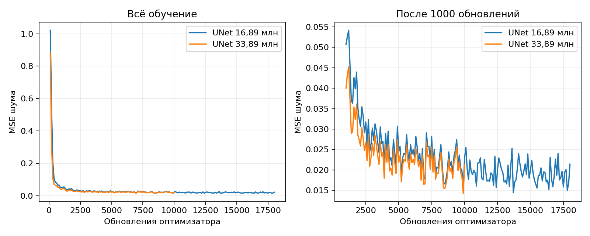
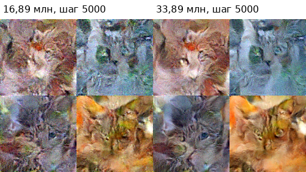
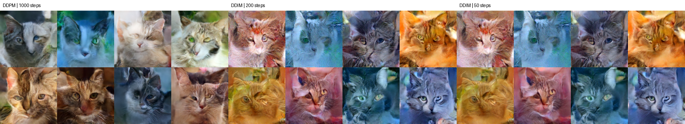
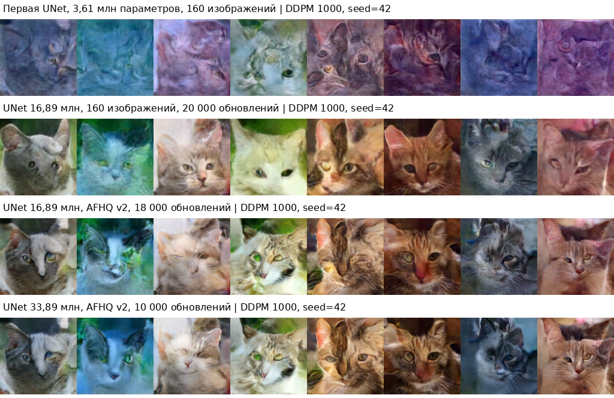
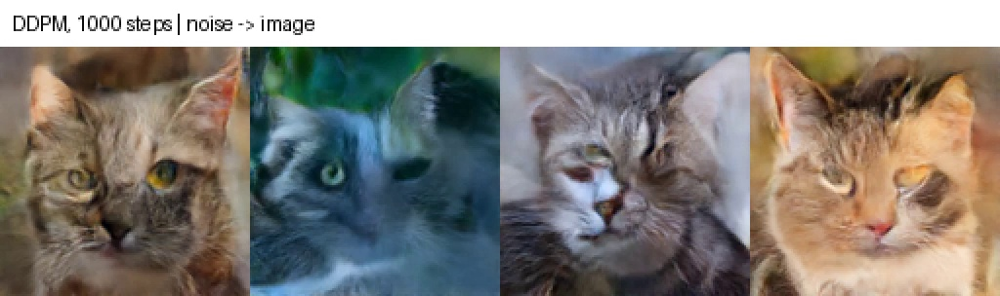

# Обучение диффузионной модели на изображениях котов

## Данные и постановка задачи

В этой работе я обучал модель, которая генерирует изображения котов из случайного шума. Сначала использовал [huggan/few-shot-cat](https://huggingface.co/datasets/huggan/few-shot-cat), где всего 160 изображений. Затем перешёл на котов из [AFHQ v2](https://github.com/clovaai/stargan-v2#animal-faces-hq-dataset-afhq), чтобы увеличить разнообразие данных.

В загруженном официальном архиве получилось **5065 обучающих изображений и 493 проверочных**. Исходные изображения имеют размер 512×512. Проверочная часть в архиве называется `test`, а локально сохраняется в `val/cat`; в обучение она не попадает. Данные AFHQ распространяются авторами NAVER по CC BY-NC 4.0 и используются здесь в учебных целях. Состав и источник архива записаны в [dataset_info.json](results/dataset_info.json).

Предобработка: RGB, уменьшение до **128×128**, нормализация в диапазон `[-1, 1]`. Для train случайно отражаю изображение по горизонтали. Картинки читаются с диска по мере необходимости. Проверочные изображения не аугментируются.

## Модель и обучение

Использую `UNet2DModel` из Diffusers. У сети пять уровней с разрешениями 128, 64, 32, 16 и 8, по два residual-блока на уровень, skip connections и attention на низких разрешениях. Модель работает непосредственно с RGB-изображениями, без отдельного автоэнкодера и без conditioning.

Проверил два размера сети:

| Модель | Каналы по уровням | Параметры | Checkpoint для генерации | Проходы по train |
|---|---|---:|---:|---:|
| Базовая | 32, 64, 128, 128, 256 | 16 887 619 | 18 000 обновлений | около 14,21 эпохи |
| Большая | 48, 88, 184, 184, 360 | 33 888 531 | 10 000 обновлений | около 7,89 эпохи |

Большая модель примерно вдвое больше по числу параметров. Обе обучал с нуля. Общие настройки: batch size 4, AdamW, начальный learning rate `1e-4`, 500 шагов прогрева, cosine learning rate, FP16 и EMA с предельным decay 0,999. Seed — 42. Для генерации использую EMA-веса. GPU — **NVIDIA GeForce RTX 3050 Laptop GPU, 4 ГиБ**.

В прямом процессе выбираю случайный шаг `t` и добавляю гауссовский шум к изображению. Расписание шума линейное, всего 1000 diffusion timesteps:

```text
x_t = sqrt(alpha_bar_t) * x_0 + sqrt(1 - alpha_bar_t) * noise
loss = MSE(predicted_noise, noise)
```

Модель получает `x_t` и `t` и предсказывает добавленный шум. MSE подходит здесь, потому что целевой шум известен и можно непосредственно сравнить его с предсказанием. После backward выполняю обновление AdamW и EMA. Логирую loss, сохраняю веса и периодически генерирую картинки из одного и того же начального шума.

Дополнительно считаю ошибку предсказания шума на восьми фиксированных изображениях train и восьми из validation. Это небольшая диагностика, а не оценка по всему validation и не FID.

## Установка

Нужен Python 3.10–3.12. Команды выполнять из папки `hw2`. Для Linux/WSL и NVIDIA GPU:

```bash
python3 -m venv .venv
source .venv/bin/activate
python -m pip install torch==2.6.0 torchvision==0.21.0 --index-url https://download.pytorch.org/whl/cu124
python -m pip install -r requirements.txt
```

Для Windows создать окружение командой `python -m venv .venv`, а в остальных командах вместо `python` использовать `.\.venv\Scripts\python.exe`. CUDA-версия PyTorch устанавливается той же командой с `--index-url`.

## Генерация готовой моделью

Веса двух моделей приложены в `models`. Они разделены на части без изменения точности. Восстановление выполняется без сети и проверяет контрольные суммы:

```bash
python prepare_weights.py
```

Затем можно запускать методы отдельно или сравнить их на одном checkpoint:

```bash
python sample.py --method ddpm --steps 1000 --count 8 --output outputs/ddpm
python sample.py --method ddim --steps 200 --count 8 --output outputs/ddim200
python sample.py --method ddim --steps 50 --count 8 --output outputs/ddim50
python sample.py --compare --count 8 --demo --demo-method ddpm --output outputs/comparison
```

По умолчанию выбрана большая модель. Базовая запускается так:

```bash
python sample.py --checkpoint models/afhq_base/model.pt --compare --output outputs/base
```

`--seed` задаёт начальный шум, `--repeats` — число повторений замера, `--device cpu` позволяет запускать без CUDA, но медленнее. В результатах сохраняются сетки, отдельные PNG, CSV и JSON со временем генерации.

## Загрузка данных и обучение

Для генерации готовыми весами датасет не нужен. Для повторного обучения сначала подготовить данные:

```bash
python prepare_afhq.py
```

Скрипт загружает официальный общий архив AFHQ v2 и извлекает только котов, проверяя изображения. Для скачивания и распаковки нужно примерно 10 ГиБ свободного места. Исходный архив удаляется после успешной подготовки. Если архив уже скачан, можно передать `--archive path/to/afhq_v2.zip`.

Базовая модель:

```bash
python train.py --train-dir data/afhq_v2/train/cat --val-dir data/afhq_v2/val/cat --dataset-name AFHQ-v2-cat --model-size base --image-size 128 --batch-size 4 --max-steps 18000 --output runs/base
```

Большая модель с часовым ограничением:

```bash
python train.py --train-dir data/afhq_v2/train/cat --val-dir data/afhq_v2/val/cat --dataset-name AFHQ-v2-cat --model-size large --image-size 128 --batch-size 4 --max-steps 20000 --time-limit-minutes 60 --output runs/large
```

`max-steps` — число успешных обновлений оптимизатора, а не diffusion timesteps. Число обновлений при ограничении по времени зависит от скорости GPU. В отчёте сравниваю сохранённые checkpoints на 18 000 и 10 000 обновлений.

Для возобновления указать те же параметры и добавить `--resume runs/large/latest.pt`. `latest.pt` содержит обычные веса, optimizer, EMA и состояние случайных чисел. `model.pt` — компактные EMA-веса для генерации. После обучения:

```bash
python sample.py --checkpoint runs/large/model.pt --compare --demo --demo-method ddpm --output outputs/trained
```

## Результаты обучения



Ошибка быстро падает в начале, затем снижение становится медленнее. По одному loss качество картинки оценивать нельзя: он измеряет предсказание шума на случайных `t`, а не сходство с реальной фотографией.

На одинаковом шаге 5000 большая модель даёт более чистые превью. На восьми фиксированных проверочных изображениях при `t=500` noise MSE составляет **0,00415 против 0,00522** у базовой. Это полезный признак, но небольшой диагностический набор не заменяет оценку качества на большом числе генераций.



## DDPM и DDIM

DDPM проходит последовательность шагов удаления шума и добавляет случайность на промежуточных шагах. DDIM использует выбранное подмножество шагов. Здесь для DDIM задано `eta=0`, поэтому при фиксированном начальном шуме генерация детерминирована. Использовал [DDPM](https://arxiv.org/abs/2006.11239) и [DDIM](https://arxiv.org/abs/2010.02502), реализованные планировщиками Diffusers.

Сравнение ниже получено на **одной большой модели, checkpoint 10 000**, EMA-веса, seed 42, FP32 при сэмплинге. Для каждого метода создаётся тот же начальный шум. Перед замером прогреваю CUDA и синхронизирую GPU. Время загрузки весов, сохранения файлов и записи демо в замер не входит. Сделал по одному измерению каждого метода; небольшую разницу по времени не считаю значимой.

| Метод | Шаги | Время на 8 изображений, с | Время на изображение, с |
|---|---:|---:|---:|
| DDPM | 1000 | 159,35 | 19,92 |
| DDIM | 200 | 31,95 | 3,99 |
| DDIM | 50 | 8,25 | 1,03 |



DDPM в этих примерах даёт более естественные цвета. DDIM значительно быстрее, но оставляет заметные синие и розовые оттенки. Между DDIM 200 и DDIM 50 разница на этой небольшой выборке не очень велика. Для итоговых примеров я выбрал DDPM, а DDIM 50 удобен для быстрых промежуточных превью.

Исходные измерения: [timings.csv](results/large/timings.csv) и [timings.json](results/large/timings.json). Результаты базовой модели: [сравнение](results/base/comparison.png), [время](results/base/timings.csv).

## Дополнительные эксперименты и вывод

Я сравнил первоначальную модель, увеличенную сеть на 160 изображениях и две модели на AFHQ. Результаты небольшого датасета сохранены в [initial](results/initial/) и [few_shot](results/few_shot/).



Увеличение датасета и модели уменьшило шум и сделало мордочки чётче. Но увеличение сети само по себе не решило все проблемы: остаются искажения глаз и ушей, неестественные цвета и размытые детали. На AFHQ число проходов по данным гораздо меньше, чем на наборе из 160 изображений. Финальные модели сравниваются при разном числе обновлений, поэтому это не строгий эксперимент только на влияние размера сети.

Более длительное обучение стоит проверять по генерациям и validation, а не только по train loss. В дальнейшем я бы также сравнил другое расписание шума и генерацию на большем числе seed. FID в этой работе не вычислял: качество оценивал визуально и по промежуточным результатам.

## Демо

[Видео генерации, 12 секунд](results/large/demo.mp4) показывает DDPM на 1000 шагах для четырёх изображений. Это ускоренная визуализация движения от шума к результату; реальное время генерации приведено в таблице выше.


