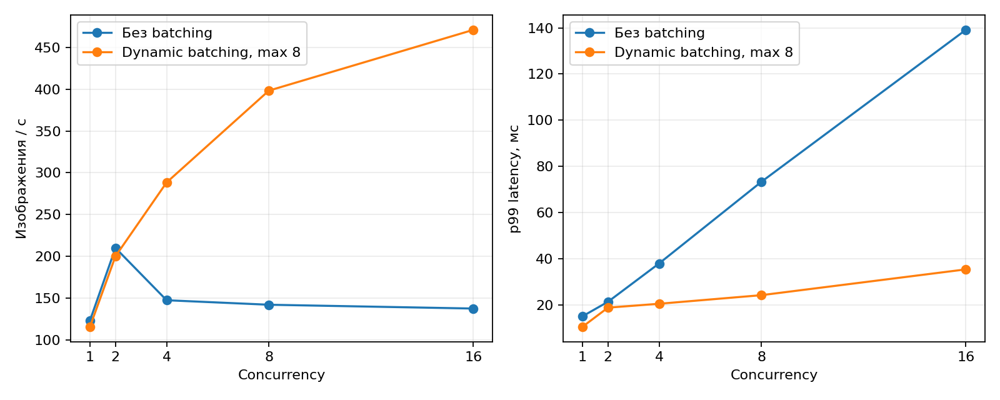

# Инференс ResNet-18 через Triton

## Модель и решение

Для этой работы я выбрал готовый [ResNet-18 из Torchvision](https://docs.pytorch.org/vision/stable/models/generated/torchvision.models.resnet18.html) с весами `IMAGENET1K_V1`. Это свёрточный классификатор с residual connections, который предсказывает один из 1000 классов ImageNet. У модели 11 689 512 параметров, дополнительного обучения не требуется.

Использовал [Python backend Triton](https://docs.nvidia.com/deeplearning/triton-inference-server/user-guide/docs/python_backend/README.html), чтобы запускать PyTorch и добавить метрики прямо в обработчик. Изображение подготавливается на клиенте: RGB, resize короткой стороны до 256, center crop 224×224, нормализация ImageNet.

Вход модели — `IMAGE`, FP32 `[batch, 3, 224, 224]`; выход — `LOGITS`, FP32 `[batch, 1000]`. Клиент вычисляет softmax и выводит top-5. В обработчике объединяю пришедшие запросы, выполняю один forward и разделяю ответы обратно.

## Установка и запуск

Нужны Linux/WSL2, Docker, `curl`, NVIDIA GPU с драйвером и [NVIDIA Container Toolkit](https://docs.nvidia.com/datacenter/cloud-native/container-toolkit/latest/install-guide.html). Все Python-зависимости устанавливаются внутри образа и зафиксированы в `requirements.txt`. Базовый образ — `nvcr.io/nvidia/tritonserver:23.12-py3`, NumPy 1.26.4. Профилировщик берётся из образа `23.12-py3-sdk`.

Если Toolkit ещё не установлен, можно использовать официальный способ по ссылке выше либо `sudo bash setup_gpu.sh`. Эта установка выполняется один раз. Проверка доступа Docker к GPU:

```bash
cd hw3
bash run.sh check-gpu
```

Все следующие команды выполнять из `hw3`. Порты 8000, 8001 и 8002 должны быть свободны.

Сборка и запуск выбранной конфигурации одной командой:

```bash
bash run.sh optimized
```

Сервер готов после сообщения `ResNet-18 готов`. HTTP работает на 8000, gRPC на 8001, метрики на 8002. Веса и имена классов приложены; при отсутствии весов `prepare.py` загружает их из Torchvision при сборке. При недоступности NVIDIA Registry скрипт умеет использовать публичное зеркало образов.

```bash
# Запросы HTTP и gRPC.
bash run.sh client examples/dog.jpg examples/cat.jpg --output outputs/http.json
bash run.sh client examples/dog.jpg examples/cat.jpg --protocol grpc --output outputs/grpc.json

# Отправить два изображения одним запросом на оптимизированном сервере.
bash run.sh client examples/dog.jpg examples/cat.jpg --batch --output outputs/batch.json

# Проверить результаты и метрики.
bash run.sh check examples/dog.jpg examples/cat.jpg --batch --output outputs/correctness.json

# Логи и остановка.
bash run.sh logs
bash run.sh stop
```

В примерах получились классы `Samoyed` для собаки и `tabby` для кота. Результаты HTTP и gRPC совпали с локальным ResNet-18 при одинаковом batch size: максимальная абсолютная разница logits — 0. Примеры ответов: [HTTP](results/predictions_http.json), [gRPC](results/predictions_grpc.json), [batch](results/predictions_optimized_batch.json).

Источник картинки собаки — [пример PyTorch](https://github.com/pytorch/hub/blob/master/images/dog.jpg), кота — [huggan/few-shot-cat](https://huggingface.co/datasets/huggan/few-shot-cat).

## Кастомные метрики

Метрики доступны на `http://localhost:8002/metrics`:

| Метрика | Тип | Что измеряет |
|---|---|---|
| `resnet18_processing_seconds_total` | COUNTER | Сумму длительностей обработки запросов в секундах |
| `resnet18_requests_in_progress` | GAUGE | Число запросов, которые сейчас находятся внутри `execute()` |

Время обработки включает подготовку тензоров, forward и создание ответов, но не очередь Triton и сеть. Если несколько запросов объединены, каждый провёл в обработке длительность общего batch; COUNTER учитывает сумму этих длительностей. Поэтому это не время занятости GPU. GAUGE считает запросы, а не картинки, и уменьшается в `finally`, в том числе при ошибке.

Я проверил метрики на 400 запросах из восьми потоков. У оптимизированной конфигурации COUNTER вырос с **0,07755 до 3,80073 с**, GAUGE под нагрузкой достигал **5**, а после завершения вернулся к **0**. Проверка также подтверждает, что COUNTER не уменьшался. Результаты: [исходная конфигурация](results/correctness.json), [оптимизированная](results/correctness_optimized.json), [снимок метрик](results/correctness_optimized.metrics.txt).

## Performance Analyzer

Исходная конфигурация: один GPU instance, `max_batch_size=1`, без dynamic batching. Её запуск и нагрузочный тест:

```bash
bash run.sh start
bash run.sh perf --output results/perf_baseline
bash run.sh stop
```

`perf_analyzer` запускается в отдельном SDK-контейнере с `--net host`. Использую gRPC, batch клиентского запроса 1 и concurrency 1, 2, 4, 8, 16. Concurrency означает число одновременно отправленных запросов. Входы синтетические: замер не включает чтение JPEG и resize на клиенте. Измерительное окно — 5 с, допуск стабильности — 20%, максимум 20 попыток.

Все замеры выполнены на **NVIDIA GeForce RTX 3050 Laptop GPU, 4 ГиБ**, модель считает в FP32. Задержки приведены в миллисекундах.

| Concurrency | Исходный throughput, изображений/с | Исходная avg latency | Исходная p99 | Оптимизированный throughput | Оптимизированная avg latency | Оптимизированная p99 |
|---:|---:|---:|---:|---:|---:|---:|
| 1 | 123,096 | 8,118 | 14,951 | 115,545 | 8,650 | 10,396 |
| 2 | 209,968 | 9,520 | 21,257 | 200,092 | 9,990 | 18,727 |
| 4 | 147,431 | 27,100 | 37,875 | 288,409 | 13,863 | 20,410 |
| 8 | 142,042 | 56,242 | 73,250 | 398,337 | 20,073 | 24,135 |
| 16 | 137,488 | 116,002 | 139,142 | 471,088 | 33,913 | 35,316 |



При concurrency 16 исходная модель обрабатывает изображения по одному: среднее время очереди достигает 108,024 мс. У выбранной конфигурации throughput выше в **3,43 раза**, а средняя latency снижается с 116,002 до 33,913 мс. При concurrency 1–2 выигрыша почти нет, поскольку запросов недостаточно для формирования большого batch.

Фактический средний batch выбранного сервера при concurrency 1, 2, 4, 8, 16 составил **1, 1, 2, 4 и 7,993**. Это посчитано по отношению `inference_count` к `execution_count`. Нулевое дополнительное ожидание не отключает batching: Triton может объединять уже накопившиеся запросы.

Исходные CSV, логи и статистика сервера: [perf_baseline](results/perf_baseline/) и [perf_optimized](results/perf_optimized/). В CSV Performance Analyzer задержки указаны в микросекундах; для таблицы и графика они переведены в миллисекунды.

## Model Analyzer

Model Analyzer установлен в серверный образ. Использую `local` launch mode: он запускает Triton внутри того же контейнера с доступными зависимостями. Конфигурация перебора — [configs/analyzer.yaml](configs/analyzer.yaml).

```bash
# Сервер должен быть остановлен перед подбором конфигураций.
bash run.sh analyze
```

Перебирал max batch 4, 8 и 16; один или два GPU instance; ожидание batch 0 или 1000 мкс. Вместе с исходной конфигурацией получилось **13 вариантов и 65 точек нагрузки**. Критерий выбора — максимальный throughput при **p99 ≤ 50 мс**.

| Вариант | Max batch | Instances | Ожидание, мкс | Concurrency | Throughput, изображений/с | p99, мс |
|---|---:|---:|---:|---:|---:|---:|
| `resnet18_config_1` | 8 | 1 | 0 | 16 | 470,2 | 36,3 |
| `resnet18_config_7` | 8 | 1 | 1000 | 16 | 458,2 | 48,9 |
| `resnet18_config_0` | 4 | 1 | 0 | 8 | 405,6 | 23,2 |
| `resnet18_config_10` | 8 | 2 | 1000 | 8 | 404,3 | 31,9 |
| Исходный вариант | 1 | 1 | — | 2 | 222,1 | 17,0 |

Выбрал `resnet18_config_1`. Дополнительное ожидание 1 мс не улучшило throughput и увеличило p99. Вариант с batch 4 даёт меньшую задержку в своей лучшей точке, но уступает по максимальной пропускной способности. Batch 16 не оказался лучше при ограничении p99: у `resnet18_config_2` при concurrency 16 она составляет 54,8 мс.

Два instance также не обогнали лидера. По GPU Memory Usage вариант `config_10` занимает 1575,0 MB против 1298,1 MB у выбранного. Эта метрика показывает общую занятую память GPU, а не только размер весов.

Конфигурация уже сохранена в [configs/optimized.pbtxt](configs/optimized.pbtxt). Для повторного выбора и независимой проверки:

```bash
python3 select_config.py results/model_analyzer/models/resnet18_config_1/config.pbtxt
bash run.sh optimized
bash run.sh perf --output results/perf_optimized
bash run.sh stop
```

Независимый Performance Analyzer подтвердил результат: **471,088 изображения/с и p99 35,316 мс** при concurrency 16. Лучший throughput по всем уровням нагрузки вырос с 209,968 до 471,088 изображения/с, то есть в **2,24 раза**.

Отчёты Analyzer: [сводный PDF](results/model_analyzer/reports/summaries/resnet18/result_summary.pdf), [подробные PDF](results/model_analyzer/reports/detailed/), [CSV всех вариантов](results/model_analyzer/results/metrics-model-inference.csv), [GPU-метрики](results/model_analyzer/results/metrics-model-gpu.csv). Основание выбора также сохранено в [selection.json](results/selection.json).

## Вывод

Удалось запустить готовую модель в Triton, проверить HTTP/gRPC и обе метрики, а затем улучшить обслуживание параллельных запросов за счёт dynamic batching. Для этого эксперимента достаточно одного instance и max batch 8. Ограничение p99 50 мс использовал как критерий выбора в проведённом тесте; результаты на другом GPU или при другой нагрузке могут отличаться.
